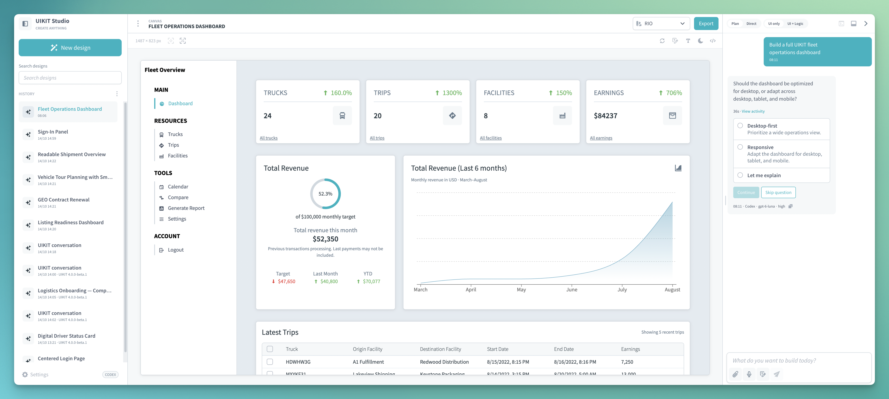

# UIKIT Studio

UIKIT Studio turns ideas into interactive React interfaces built with RIO UIKIT. Describe what you want to build in natural language, explore the generated result in a live preview, and refine it with your team.

Learn more on the [UIKIT Studio landing page](https://rio.cloud/en/landingpage/uikit-studio).

Download the [latest released version](https://github.com/rio-cloud/uikit-studio/releases/latest).

## From idea to handoff

1. **Describe** the audience, purpose, and interactions you have in mind. Use Plan mode to shape and approve a plan first, or choose Direct mode to start building immediately.
2. **Explore** the generated React interface in an isolated, interactive canvas. Try the UI and check it at different viewport sizes.
3. **Refine** the design with annotations, direct text edits, or code changes in the integrated editor. Studio keeps AI-generated revisions in the design history so you can return to an earlier version and continue from there.
4. **Hand off** a runnable React/TypeScript project with a preview, design handoff, and a file that can be imported into Studio later.

## Built for RIO UIKIT

Studio guides AI generation with rules for the selected UIKIT version and validates the resulting classes and React/TypeScript code before showing it in the preview. The canvas supports interactive prototypes, brand themes, and both light and dark Studio themes.

## Local-first workflow and AI choice

Choose the AI setup that fits your workflow: a locally installed Codex or Kiro CLI, models through AWS Bedrock, or a compatible service such as OpenRouter. Agent output is checked before it appears in the isolated canvas.

When using a local CLI, a model service may still process requests. Which content leaves your machine depends on the provider you choose.

## Planned

- Import Figma designs as a starting point for clickable prototypes.
- Open and extend existing projects in Studio.
- Build interfaces visually by selecting and placing UIKIT components.
